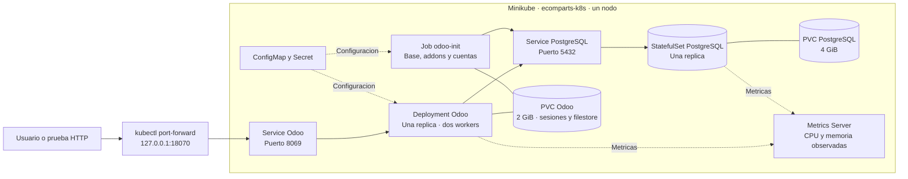

# Bloque 2 Odoo con una replica en Minikube

Responsable: Frank. Este bloque despliega la imagen del Odoo del repositorio con sus addons, prepara PostgreSQL persistente y comprueba el acceso por Service, las probes, el consumo de recursos y la conservacion de datos al reemplazar Pods.

## Preparacion del equipo

Requisitos: Windows de 64 bits, Docker Desktop con contenedores Linux y Python. El lanzador descarga Minikube 1.39.0 y kubectl 1.37.0 desde sus distribuciones oficiales y verifica los SHA256. Los binarios quedan en `.tools/`.

El perfil `ecomparts-k8s` usa Kubernetes 1.37.0, containerd, cuatro CPU y 4096 MB de memoria. Su estado y kubeconfig se guardan en `.lab/`; los comandos del lanzador apuntan explicitamente a ese contexto y al namespace `ecomparts`.

```powershell
.\scripts\kubernetes.ps1 -Action Up
.\scripts\kubernetes.ps1 -Action Check -Seed
```

`Up` construye la imagen, le asigna una etiqueta derivada de su ID, la carga en Minikube, despliega PostgreSQL y ejecuta el Job de inicializacion. Cuando el Job termina, despliega una replica de Odoo y abre un tunel local hacia su Service.

Odoo: <http://127.0.0.1:18070/web/login?db=ecomparts_odoo_shared>.

Las credenciales locales se generan en `.env.k8s`, excluido de Git. El usuario de administracion figura en `ODOO_ADMIN_LOGIN` y su contrasena en `ODOO_ADMIN_PASS`. El Secret se crea desde ese archivo; sus valores no forman parte de los manifiestos versionados.

## Arquitectura de este bloque



Las companias comparten una base de Odoo. La imagen incluye los addons; el cluster no depende de un montaje del codigo del equipo anfitrion. El PVC de Odoo conserva tanto el filestore como las sesiones.

El almacenamiento utiliza la StorageClass `standard` de Minikube, con acceso `ReadWriteOnce`. Este laboratorio tiene un solo nodo y una instancia de PostgreSQL.

## Configuracion de recursos

| Componente | CPU solicitada | CPU maxima | RAM solicitada | RAM maxima |
|---|---:|---:|---:|---:|
| Odoo | 500m | 1500m | 768 MiB | 1536 MiB |
| PostgreSQL | 100m | 500m | 128 MiB | 512 MiB |
| Job de inicializacion | 250m | 1000m | 512 MiB | 1536 MiB |

Odoo utiliza dos workers HTTP, `db_maxconn = 8` y cron desactivado para el laboratorio. Los limites de memoria por worker son 384 MiB soft y 512 MiB hard. Esta configuracion se registra como parte de la evidencia; todavia no representa un benchmark de rendimiento.

Las probes de arranque y disponibilidad de Odoo consultan `/web/health?db_server_status=true`, que comprueba la conexion a PostgreSQL. La probe de vida consulta `/web/health`. PostgreSQL utiliza `pg_isready` para arranque y disponibilidad, y una comprobacion TCP para vida.

## Validacion y persistencia

`Check -Seed` prepara el conjunto minimo de tres companias del laboratorio y comprueba login, addons, catalogo, stock, pedidos y permisos.

Las cuentas son `lab-a@ecomparts.local`, `lab-b@ecomparts.local` y `lab-c@ecomparts.local`. Sus contrasenas se forman con el valor local de `ODOO_ADMIN_PASS` seguido de `-A`, `-B` o `-C`, respectivamente. Cada usuario esta restringido a su compania.

La comprobacion de persistencia realiza estos pasos:

1. Crea un contacto de prueba y un adjunto almacenado en el filestore.
2. Registra los UID de los Pods y del Service.
3. Elimina el Pod de Odoo y espera a su reemplazo disponible.
4. Reabre el tunel al mismo Service y verifica el contacto y el contenido del adjunto.
5. Reemplaza el Pod de PostgreSQL y repite la comprobacion.
6. Comprueba que el Service conserva su UID y registra CPU, RAM, requests, limits y estado de los PVC.

El tunel de `kubectl port-forward service/odoo` se conecta a un Pod concreto. Debe reabrirse al reemplazar ese Pod; el lanzador lo hace durante la prueba. La validacion se realiza por el Service y conserva su identidad y direccion interna.

```powershell
# Revisar recursos, Pods, Service y volumenes.
.\scripts\kubernetes.ps1 -Action Status

# Volver a abrir el acceso local si se cerro el proceso del tunel.
.\scripts\kubernetes.ps1 -Action Forward

# Repetir la validacion sobre los datos existentes.
.\scripts\kubernetes.ps1 -Action Check

# Detener el perfil conservando sus datos.
.\scripts\kubernetes.ps1 -Action Stop
```

`Check` reemplaza los Pods de este laboratorio y produce una interrupcion temporal. Debe ejecutarse fuera de una corrida de carga. `Stop` cierra el tunel y detiene el perfil; no elimina el perfil ni sus PVC.

## Archivos de infraestructura

- [Namespace](../k8s/namespace.yaml).
- [ConfigMap mediante Kustomize](../k8s/config/kustomization.yaml) y [plantilla Odoo](../k8s/config/odoo.conf.tpl).
- [PostgreSQL, Service y almacenamiento](../k8s/infrastructure/postgres.yaml).
- [PVC de Odoo](../k8s/infrastructure/odoo-storage.yaml).
- [Job de inicializacion](../k8s/jobs/odoo-init.yaml).
- [Deployment de Odoo](../k8s/odoo/deployment.yaml) y [Service](../k8s/odoo/service.yaml).
- [Lanzador PowerShell](../scripts/kubernetes.ps1).
- [Prueba de registro y filestore](../scripts/verify_kubernetes_persistence.py).

## Trabajo compartido en la rama Kubernetes

Para obtener la rama publicada:

```powershell
git fetch origin
git switch Kubernetes
.\scripts\kubernetes.ps1 -Action Up
.\scripts\kubernetes.ps1 -Action Check -Seed
```

Cada equipo crea sus propias credenciales y volumenes. `.env.k8s`, `.lab/` y `.tools/` permanecen locales.

Jesus puede adaptar los datos de prueba y preparar Locust para autenticacion, productos y stock. Desde otro Pod del namespace, la direccion es `http://odoo:8069`; desde este equipo, con el tunel abierto, es `http://127.0.0.1:18070`.

Las pruebas de varias replicas corresponden al bloque 3. El benchmark con cargas concurrentes corresponde al bloque 4 y el HPA al bloque 5.

## Evidencia

Estado de la tarea de Frank: implementada y validada el 22 de noviembre de 2026.

| Comprobacion | Resultado |
|---|---|
| Nodo Minikube | Kubernetes 1.37.0, estado Ready. |
| Imagen del repositorio | Construida con addons, etiquetada por ID y cargada desde Docker local. |
| PostgreSQL | StatefulSet de una replica con PVC de 4 GiB en estado Bound. |
| Odoo | Deployment de una replica, probes aprobadas y PVC de 2 GiB en estado Bound. |
| Inicializacion | Job finalizado correctamente antes del despliegue web. |
| Tres companias | Login, catalogo, stock, pedidos y aislamiento aprobados. |
| Recreacion del Pod de Odoo | Nuevo UID; registro y adjunto conservados. |
| Recreacion del Pod de PostgreSQL | Nuevo UID; registro y adjunto conservados. |
| Service de Odoo | Mismo UID y direccion interna durante la prueba. |
| Metricas observadas | Odoo: 393m CPU y 417 MiB RAM. PostgreSQL: 27m CPU y 35 MiB RAM. |

Las metricas son una muestra tomada despues de las comprobaciones de persistencia, con marcas de tiempo del API de metricas. Las muestras se comprobaron contra la fecha de creacion de los nuevos Pods. No son resultados de un benchmark con carga concurrente.

La evidencia sin credenciales se guarda en [evidence/bloque2.json](evidence/bloque2.json). Los resultados locales completos permanecen en `.lab/ecomparts-k8s-evidence.json` y `.lab/ecomparts-k8s-persistence.json`.

## Referencias oficiales

- [Minikube con Docker](https://minikube.sigs.k8s.io/docs/drivers/docker/).
- [Estado local de Minikube](https://minikube.sigs.k8s.io/docs/handbook/config/).
- [Probes de Kubernetes](https://kubernetes.io/docs/concepts/workloads/pods/probes/).
- [Volumenes persistentes de Minikube](https://minikube.sigs.k8s.io/docs/reference/persistent_volumes/).
- [Metricas de Pods](https://kubernetes.io/docs/reference/kubectl/generated/kubectl_top/kubectl_top_pod/).
