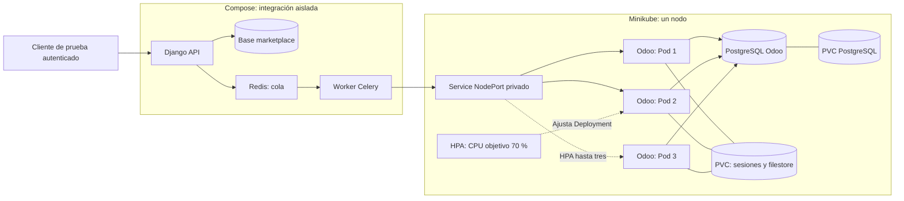

# ECOMPARTS: informe de validación breve de Kubernetes

**Responsable de infraestructura:** Frank. **Pruebas y análisis compartidos:** Jesús. **Fecha:** 23 de noviembre de 2026. **Estado:** infraestructura e integración comprobadas en laboratorio; matriz formal y revisión cruzada pendientes.

## 1. Objetivo y alcance

Preparar Odoo multiempresa para ejecutar réplicas en Kubernetes, conservar sesiones y archivos, recuperar un Pod y aumentar réplicas según CPU. Comprobar además que un pedido real de la API del marketplace llegue por Celery a la compañía correcta de Odoo.

El usuario eligió una validación breve y dejó la matriz completa para Jesús. Este informe cierra esa validación de infraestructura. El cierre del experimento de rendimiento necesita las pruebas restantes y sus conclusiones.

## 2. Antes y después

Antes, Docker Compose arrancaba una instancia de Odoo con PostgreSQL y volúmenes, junto con Django, Redis y Celery. Compose administra contenedores y puede reiniciar un proceso, pero el escenario original no tenía un controlador HPA que ajustara réplicas de Odoo según CPU.

En el laboratorio actual, Kubernetes administra de una a tres réplicas de Odoo. Un Service mantiene un punto de acceso y envía conexiones a los Pods preparados. Las réplicas comparten la base de PostgreSQL, sesiones y filestore. Un Deployment mantiene la cantidad deseada y el HPA puede modificarla.

El tercer Pod existe durante el escalado. Al entregar se conservaron dos réplicas fijas y HPA desactivado. El navegador SvelteKit queda fuera de la prueba automatizada de integración.

El nodo tiene un límite Docker de 4 CPU y 4 GiB. Kubernetes declara la capacidad de la VM subyacente, 16 CPU y unos 7,44 GiB. Para interpretar resultados manda también el límite efectivo del contenedor. Locust comparte recursos con Odoo y PostgreSQL. Cada Pod Odoo usa dos workers, cron desactivado, request de 500m/768 MiB y límite de 1500m/1536 MiB. El almacenamiento RWO compartido se restringe al mismo nodo.

## 3. Trabajo revisado y cambios

Se revisó la rama de Jesús `jesus/bloques-1-5-evidencias`, commit `f480b1d`, y su PR #3 hacia `Kubernetes`. Se conservaron sus datos BENCH, Locust, verificadores y evidencia numérica. La continuación está en `frank/kubernetes-continuacion`. El PR no se aprobó ni fusionó automáticamente.

Frank añadió preparación verificable de réplicas, almacenamiento fijado al nodo, comprobación de permisos en ambos Pods y observación de recuperación. Para los bloques 4 y 5 corrigió el protocolo de carga, preparó HPA y conectó Django/Celery al Odoo de Kubernetes mediante un proyecto Compose separado.

El protocolo 3 distingue preparación de sesiones, rampa, calentamiento y medición. Con 20 usuarios asigna A=3/B=7/C=10. Registra imagen, recursos, configuración y hashes por corrida. Rechaza una preparación incompleta y separa familias de configuración. Cuenta errores JSON-RPC aunque el transporte devuelva HTTP 200.

Las pruebas de desarrollo conservan sus cambios locales y hashes sobre el commit base `a5873ab`. No se presentan como ejecuciones formales de un commit limpio. La matriz formal exige un árbol versionado limpio y conserva también copia de sus scripts.

## 4. Evidencia de réplicas fijas

Lectura con 20 usuarios, rampa de 5 usuarios/s, 5 s de calentamiento y 30 s medidos. Una corrida por configuración, con HPA desactivado.

| Pods | Solicitudes | Fallos | p95 (ms) | Exitosas/s |
|---:|---:|---:|---:|---:|
| 1 | 1938 | 0 | 23 | 64,598 |
| 2 | 1926 | 0 | 34 | 64,198 |
| 3 | 1947 | 0 | 18 | 64,900 |

Las tres configuraciones funcionaron bajo esta carga breve. Estas ventanas no permiten afirmar una mejora de capacidad ni fijar un máximo de usuarios. Los IDs, tiempos efectivos y la firma de configuración están en la evidencia.

La prueba histórica de recuperación del bloque 3 registró 5522 solicitudes, tres fallos y 6,008 s hasta observar dos Pods listos después de solicitar la eliminación de uno. El Service conservó su identidad. La sesión, el adjunto y los permisos A/B/C pasaron en ambos Pods después de la recuperación. Su protocolo y objetivo difieren de la prueba de capacidad.

## 5. Evidencia del HPA

El HPA utiliza mínimo un Pod y máximo tres. Su objetivo de CPU es el 70 % de 500m solicitados por Pod, equivalente a 350m. Puede subir un Pod por 30 s y bajar uno por 30 s, con 60 s de estabilización para la demostración.

La corrida válida `202611231840403600` mantuvo 100 usuarios durante 120 s medidos. El registro final contiene 15048 solicitudes, 18 fallos, error de 0,120 %, p95 de 2100 ms y 125,250 operaciones exitosas/s.

| Observación | Hora UTC | Hora Lima |
|---|---|---|
| Inicio de medición con 100 usuarios | 23:41:33 | 18:41:33 |
| Dos Pods observados listos | 23:42:18 | 18:42:18 |
| Tres Pods observados listos | 23:42:49 | 18:42:49 |
| Fin de medición | 23:43:33 | 18:43:33 |

Los dos Pods nuevos recibieron POST `call_kw` con HTTP 200. Una captura posterior sin carga confirmó un Pod deseado y listo. Las observaciones están limitadas por el intervalo real de muestreo, aproximadamente 5 s más el tiempo de consultas.

Los 18 fallos fueron de transporte. El escalado funcionó y los errores permanecen como un resultado que analizar. Tres intentos previos con 200 usuarios no completaron la preparación y se excluyeron. El protocolo corregido se comprobó con 100; la carga de 200 corresponde a las pruebas pendientes.

Se usan `final.json` y `timing.json` para los totales. El CSV periódico del HPA terminó con 14985 solicitudes porque su último muestreo ocurrió antes del cierre. El archivo `measured_summary.csv` consolida los totales finales, evitando mezclar ambos instantes.

## 6. Integración y corrección del cliente nuevo

Se levantó `ecomparts-lab-integration`, con su propia base marketplace y sus volúmenes. Un cliente autenticado creó pedidos y subió comprobantes por HTTP. Un worker Celery real procesó la cola y creó las ventas borrador en el Odoo de Kubernetes. La verificación comparó compañía, referencia de SubOrder, producto y cantidad.

| Tienda | SubOrder | Venta Odoo | Compañía Odoo |
|---|---|---:|---:|
| A | ORD-2026-00004-A | 6 | 2 |
| B | ORD-2026-00005-A | 7 | 3 |
| C | ORD-2026-00006-A | 8 | 4 |

Los tres pedidos y los tres comprobantes devolvieron HTTP 201. Los logs del contenedor Celery identifican la creación de cada venta. El sufijo `-A` del número identifica la primera suborden de cada pedido; no identifica la compañía.

La primera ejecución detectó que el conector pasaba `[id]` al campo de relación del cliente, que exige un entero. Se normalizó y validó el resultado de crear partner, fuente de origen y venta. Pasaron las tres pruebas nuevas de regresión y las tres anteriores de configuración de Odoo. Se repitió la integración con otro cliente nuevo y las tres tiendas pasaron. También pasaron siete comprobaciones de las herramientas de benchmark.

Esta evidencia llega a una venta borrador después de subir un comprobante sintético. No demuestra aceptación bancaria del pago, despacho de stock ni comportamiento del navegador de la tienda.

## 7. Ejemplo de una tienda y vocabulario

Ana compra un filtro del proveedor A. Django recibe el pedido y guarda el registro de la tienda. Cuando Ana sube su comprobante, Django deja una tarea en Redis. Celery la recoge y registra la venta en la compañía A de Odoo. El comprobante sigue pendiente de revisión.

Si hay dos Pods Odoo, cualquiera puede atender la siguiente conexión. Ambos consultan la misma base y encuentran la misma sesión y foto. Si un Pod deja de funcionar, el Deployment crea otro. Si aumenta el uso de CPU, el HPA puede pedir más Pods, dentro del máximo configurado. Todo sigue dependiendo del mismo equipo y PostgreSQL.

| Término | Significado técnico | Ejemplo de repuestos |
|---|---|---|
| Pod | Unidad donde Kubernetes ejecuta Odoo | Un puesto de atención con el mismo sistema |
| Réplica | Otra instancia del mismo servicio | Otro puesto que consulta el mismo inventario |
| Worker | Proceso que atiende trabajo dentro de Odoo | Un empleado dentro de ese puesto |
| Service | Dirección estable hacia Pods preparados | El número de atención que dirige al puesto libre |
| Deployment | Controlador que mantiene las réplicas deseadas | El encargado que repone un puesto averiado |
| PVC | Solicitud de almacenamiento persistente | Archivo común donde quedan fotos y sesiones |
| PostgreSQL | Base de datos compartida de Odoo | Libro central de productos y pedidos |
| Redis / Celery | Cola de tareas / procesos que las ejecutan | Bandeja de encargos / personal que los tramita |
| HPA | Controlador de réplicas según una métrica | Encargado que abre puestos al aumentar el trabajo |
| p95 | El 95 % de solicitudes tarda ese valor o menos | De 100 consultas, unas 95 terminan antes de ese tiempo |

Las analogías ayudan a imaginar el flujo. CPU mide trabajo del servidor y no cuenta directamente personas esperando. Una compañía de Odoo no tiene un Pod exclusivo: los Pods atienden todas las compañías respetando sus permisos.

## 8. Entrega y criterios de cierre

Jesús recibe el procedimiento y una matriz reanudable. Por modo son 36 corridas: 1/2/3 Pods, 20/50/100/200 usuarios y tres repeticiones. Cada corrida usa 30 s de calentamiento y 300 s medidos, además de preparación y rampa. Son al menos tres horas de medición por modo. Lectura y pedidos se analizan por separado.

Para cerrar el experimento faltan ejecutar y verificar la cobertura completa, analizar p95/operaciones exitosas/errores junto con CPU/RAM/conexiones PG, repetir el pico HPA, revisar los cambios entre compañeros y actualizar las conclusiones del informe y la presentación. La prueba de interfaz y los escenarios de pago/stock deben registrarse si forman parte de la entrega funcional.

El alcance de un nodo con PostgreSQL único permite estudiar réplicas de Odoo. La pérdida del nodo o de la base requiere otro diseño y otras pruebas. No se declara alta disponibilidad del sistema completo ni una capacidad máxima a partir de esta validación breve.

## Fuentes y archivos

- [Plan compartido](https://docs.google.com/document/d/1bhAJbVwwfICd8ajIzh4CxHmDQNWdyLeU_AU3XM7Y6FE/edit).
- [PR de Jesús](https://github.com/FRANKEVIN25/MARKETPLACE/pull/3) y [rama de continuación](https://github.com/FRANKEVIN25/MARKETPLACE/tree/frank/kubernetes-continuacion).
- [Resumen público](evidence/frank-validacion-breve/summary.json), [totales CSV](evidence/frank-validacion-breve/measured_summary.csv), [integración](evidence/frank-validacion-breve/integration.json), [bloque 3](evidence/frank-bloque3.json).
- [Procedimiento técnico](BLOQUES_4_Y_5_VALIDACION_BREVE.md) y [pruebas finales para Jesús](ENTREGA_JESUS_PRUEBAS_FINALES.md).
- [Kubernetes: HPA](https://kubernetes.io/docs/tasks/run-application/horizontal-pod-autoscale/) y [modos de acceso de volúmenes](https://kubernetes.io/docs/concepts/storage/persistent-volumes/#access-modes).
- [Odoo 18: API externa](https://www.odoo.com/documentation/18.0/developer/reference/external_api.html) y [Locust: estadísticas](https://docs.locust.io/en/stable/retrieving-stats.html).
