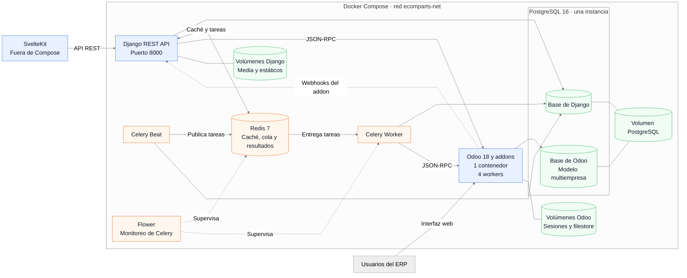
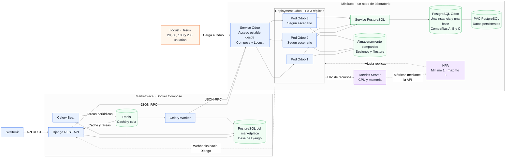

# Arquitectura de ECOMPARTS antes y después de la implementación

**Proyecto:** Marketplace multiempresa integrado con Odoo 18

**Responsable de infraestructura:** Frank

**Fecha del análisis:** 22 de noviembre de 2026

Este documento presenta la arquitectura definida actualmente en el repositorio y la propuesta para completar el plan de Odoo multiempresa en Kubernetes. El objetivo es medir cómo cambian la latencia p95, las operaciones exitosas por segundo y la tasa de errores al pasar de una a tres réplicas de Odoo.

Los diagramas conservan el punto de partida del proyecto y la propuesta de laboratorio basada en el plan de trabajo. Ya se implementaron y validaron el [Bloque 1 Docker Compose](../docs/BLOQUE_1_DOCKER_COMPOSE.md) y el [Bloque 2 con una réplica en Minikube](../docs/BLOQUE_2_MINIKUBE.md). Sus documentos incluyen comandos, configuraciones y evidencia para la revisión del equipo.

> **Para verlo grande e imprimirlo:** abre este archivo en una vista previa con soporte Mermaid. Los diagramas tienen texto ampliado. Para imprimir, utiliza orientación horizontal y ajusta cada diagrama al ancho de la página. Si dispones de papel A3, permite conservar más tamaño. Una vista que muestre solamente el código Mermaid necesita un renderizador compatible antes de imprimir.

## 1. Arquitectura inicial antes del bloque 1

El entorno principal utiliza Docker Compose. Existe un único contenedor de Odoo, una instancia de PostgreSQL para las bases de Django y Odoo, Redis y los servicios de procesamiento asíncrono. El frontend SvelteKit está en el repositorio y su ejecución se configura por separado.

### Cómo interpretar la arquitectura actual

- **Odoo tiene un contenedor y cuatro workers.** Los workers son procesos dentro del contenedor; no equivalen a cuatro réplicas.
- **PostgreSQL es una sola instancia con bases separadas.** Django almacena los datos del marketplace y Odoo conserva sus propios modelos y datos empresariales.
- **Redis atiende a Django y Celery.** Funciona como caché, broker de tareas y backend de resultados. No está configurado como almacenamiento de sesiones de Odoo.
- **Odoo persiste sesiones y adjuntos en sus volúmenes.** La plantilla establece `data_dir = /var/lib/odoo`; el filestore tiene además su propio volumen montado.
- **Django y Celery se comunican con Odoo mediante JSON-RPC.** El addon de webhooks proporciona el recorrido de vuelta desde Odoo hacia Django cuando está instalado y configurado.
- **SvelteKit no tiene servicio en Compose.** Su código existe en `services/frontend`.
- **Kubernetes todavía está pendiente.** No se encontraron manifiestos de Minikube, Deployment, Service, PVC o HPA, ni scripts de Locust.

El puerto externo predeterminado de Odoo es `8070`, conectado al puerto interno `8069`. Django expone `8000` y Flower `5555`.

## 2. Arquitectura propuesta al completar el plan

La propuesta mantiene el marketplace en Docker Compose y despliega Odoo con su PostgreSQL en Minikube. Esta distribución limita el trabajo de migración al alcance de infraestructura del plan. La migración de toda la aplicación a Kubernetes sería una ampliación del alcance.

En esta propuesta, PostgreSQL del marketplace conserva la base de Django. Odoo utiliza una instancia de PostgreSQL dentro del laboratorio de Kubernetes, inicializada con los datos de prueba acordados.

### Cómo interpretar la arquitectura propuesta

**Las tres compañías comparten la misma base de Odoo y pueden ser atendidas por cualquiera de los Pods.** Un Pod no representa una empresa. El aislamiento depende de los usuarios, los permisos y el contexto de compañía.

Las réplicas utilizan la misma imagen con los addons del repositorio y una configuración equivalente. Todas se conectan al mismo PostgreSQL y al mismo almacenamiento de sesiones y adjuntos.

El Service proporciona un punto de acceso estable aunque cambien los Pods. Para comunicar Compose y Locust con Minikube debe publicarse un endpoint accesible, por ejemplo mediante NodePort o un túnel adecuado al driver del laboratorio. También se debe configurar la dirección de Django que utilizarán los webhooks de Odoo.

El diagrama muestra la capacidad máxima de tres Pods. En el benchmark se ejecutan por separado escenarios de **uno, dos y tres Pods fijos, con HPA desactivado**. El HPA se activa después para la prueba de escalado automático.

Flower, los volúmenes de Django y otros servicios auxiliares se omiten en este segundo dibujo para concentrarlo en los cambios del laboratorio.

## 3. Responsabilidades de Frank por bloque

| Bloque | Trabajo de Frank | Resultado que debe poder demostrarse |
|---|---|---|
| **1. Validar Docker Compose** | Arrancar con volúmenes nuevos de laboratorio, alinear nombres de bases y verificar instalación de addons. Participar en las pruebas de las tres compañías. | Arranque limpio y repetible; login, catálogo, stock y pedidos disponibles con separación de datos. |
| **2. Desplegar un Pod** | Construir y etiquetar la imagen; crear Deployment de una réplica, Service y PostgreSQL persistente; configurar probes de arranque y disponibilidad; registrar CPU y RAM. | Odoo responde por el Service y los datos sobreviven a la recreación del Pod. |
| **3. Comprobar dos réplicas** | Subir a dos réplicas con la misma imagen; compartir sesiones y adjuntos; controlar cron; participar en la prueba de pérdida de un Pod. | La sesión y los adjuntos funcionan entre réplicas, se conservan los permisos y se registra la recuperación. |
| **4. Medir uno, dos y tres Pods** | Preparar réplicas fijas con HPA desactivado; conservar imagen, PostgreSQL y configuración por Pod; registrar workers, CPU, RAM, cron y conexiones. | Cada corrida queda asociada a una configuración reproducible y a sus métricas de infraestructura. |
| **5. Validar HPA e integración** | Configurar HPA de una a tres réplicas; comprobar métricas; documentar objetivo de CPU y requests; verificar con Jesús el pedido del marketplace hasta Odoo. | Escalado reproducible con evidencia y pedido registrado en la compañía correcta. |

Jesús lidera los datos de prueba, la validación funcional, Locust y el análisis. Las revisiones, las pruebas de recuperación y la validación final se realizan entre ambos.

## 4. Decisiones que deben quedar resueltas al implementar

### 4.1 Inicialización y nombre de la base de Odoo

`services/postgres/init-databases.sh` crea `ecomparts_odoo`. La configuración de Django utiliza `ecomparts_odoo_shared` como valor predeterminado cuando no recibe `ODOO_DB`.

Debe acordarse un único nombre y aplicarlo a la creación de la base, la inicialización de Odoo, las variables de Django y Celery y los manifiestos de Kubernetes. El entrypoint actual de Odoo genera la configuración y arranca el servidor; la instalación inicial de los addons debe quedar documentada y ser repetible.

### 4.2 Persistencia compartida

PostgreSQL necesita su propio volumen persistente. Las réplicas de Odoo necesitan acceso común a las sesiones y al filestore. El mecanismo de almacenamiento debe permitir que todos los Pods previstos accedan a esos archivos en el único nodo del laboratorio.

La prueba debe comprobar tanto la continuidad de una sesión entre Pods como la lectura del mismo adjunto y la conservación de datos al recrear un Pod.

### 4.3 Recursos, workers y cron

Los comentarios del Compose mencionan recursos, pero no constituyen límites efectivos. Kubernetes debe declarar los `requests` y `limits` que se utilizarán y registrar la configuración de workers por Pod.

Para las corridas comparables, se propone desactivar cron de Odoo y mantener esa condición en todos los escenarios. Si se requieren tareas cron de Odoo durante otra prueba, debe definirse una ejecución controlada y documentarla. Celery Beat es un planificador separado.

### 4.4 Escalado automático

El HPA por porcentaje de utilización de CPU necesita `requests.cpu` y métricas disponibles mediante Metrics Server. El objetivo de CPU se definirá y documentará durante la implementación.

El HPA se activa al terminar el benchmark de réplicas fijas. La prueba debe registrar cuándo comienza el pico, cuándo cambia el número de réplicas, cuándo el nuevo Pod atiende tráfico y qué ocurre con p95 y errores.

### 4.5 Integración del pedido

La validación final recorre el marketplace, Django, Redis, Celery y Odoo. En el código actual, la tarea de creación de la orden de venta se encola al subir el comprobante y pasar la suborden a revisión de pago. La prueba debe incluir ese paso y confirmar la compañía de destino.

## 5. Alcance de las mediciones

Se prueban **20, 50, 100 y 200 usuarios concurrentes**, manteniendo la misma mezcla de operaciones, proporción por compañía, rampa, calentamiento y duración. Las escrituras de pedidos se ejecutan como prueba aparte, restaurando los datos entre corridas comparables.

Los resultados deben incluir latencia promedio, p95, operaciones exitosas por segundo y tasa de errores. También deben contarse los errores JSON-RPC que lleguen dentro de respuestas HTTP 200. Frank añade CPU, RAM y conexiones de PostgreSQL.

Si cada réplica añade CPU y RAM, la comparación refleja el cambio conjunto de réplicas y recursos. Debe registrarse cualquier saturación del nodo o de PostgreSQL.

**La disponibilidad evaluada cubre la pérdida de un Pod de Odoo.** El nodo de Minikube y PostgreSQL siguen siendo componentes únicos del laboratorio.

## 6. Fuentes del análisis

- Plan proporcionado: `ECOMPARTS _ Plan de trabajo de Odoo multiempresa en Kubernetes.docx`.
- [Docker Compose](../docker-compose.yml).
- [Imagen de Odoo](odoo/Dockerfile).
- [Plantilla de configuración de Odoo](odoo/config/odoo.conf.tpl).
- [Entrypoint de Odoo](odoo/entrypoint.sh).
- [Inicialización de PostgreSQL](postgres/init-databases.sh).
- [Configuración de Django](backend/ecomparts/settings.py).
- [Conector JSON-RPC](backend/apps/sync/connector/base.py).
- [Tareas de pedidos](backend/apps/orders/tasks.py).
- [Contexto de compañía para pedidos](backend/apps/sync/services/orders.py).
- [Addon de webhooks](odoo/addons/odoo_django_webhook/models/sale_order.py).
- [Frontend SvelteKit](frontend/package.json).
- [HPA en Kubernetes](https://kubernetes.io/docs/concepts/workloads/autoscaling/horizontal-pod-autoscale/).
- [Volúmenes persistentes en Minikube](https://minikube.sigs.k8s.io/docs/reference/persistent_volumes/).
